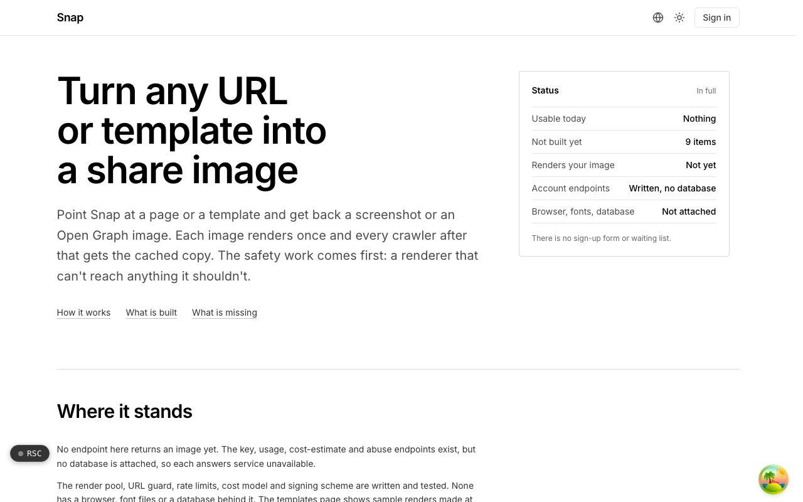
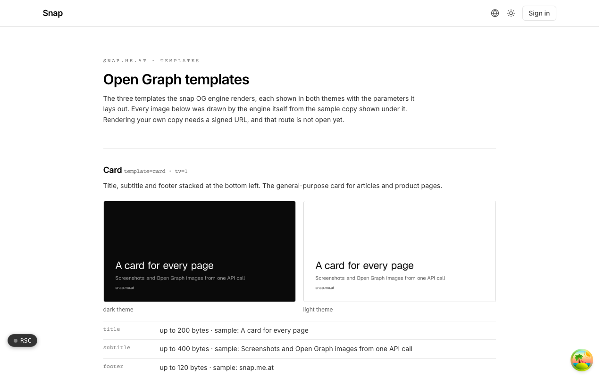

  <picture>
    <source media="(prefers-color-scheme: dark)" srcset=".github/assets/hero-dark.png">
    
  </picture>

# snap.me.at

Turn any URL or template into a share image.

snap.me.at produces screenshots and Open Graph images from a URL or a template in one API call, cached and metered per render. Each image renders once and every crawler after that gets the cached copy. The safety work comes first: a renderer that cannot reach anything it should not. The render pool, URL guard, rate limits, cost model and signing scheme are written and tested, but no public endpoint returns an image yet.

## Features

- **Screenshots and Open Graph images**: Chromium (via Playwright) captures pages; Open Graph templates are drawn without a browser.
- **SSRF-safe URL guard**: customer URLs are checked on submit and again on fetch against the resolved IP, and every redirect, subresource and child frame goes through the same guard.
- **A fresh browser context per job**: no stored data, cookies or service workers carried between jobs, with hard timeouts, download budgets and clamped viewports.
- **Render once, cache by every option**: the cache key covers every output-affecting option plus a renderer version, and concurrent callers wait on the render already in progress.
- **Signed URLs**: an HMAC over the parameters in a fixed order, scoped per surface, with unknown parameters rejected.
- **API keys with retire and revoke**: retiring stops new signing and keeps existing URLs working; revoking stops them at once and purges cached images.
- **Rate limits and a per-render cost model**: monthly, daily, per-minute and concurrent limits are checked before anything renders; cache hits and failures cost nothing.
- **MCP endpoint**: the tools are exposed over the Model Context Protocol, and tools that cost compute refuse without a session.

## Screenshots

<table>
  <tr>
    <td width="50%"><picture><source media="(prefers-color-scheme: dark)" srcset=".github/assets/templates-dark.png"></picture> Templates: the Open Graph template gallery, rendered by the engine itself in both themes</td>
  </tr>
</table>

## Built with

- Next.js 16 (App Router), React 19, TypeScript
- Tailwind CSS 4
- Playwright (Chromium render pool)
- Next.js OG image rendering for templates
- Drizzle ORM + Postgres
- Better Auth
- oRPC + TanStack Query

## Part of the me.at family

snap.me.at is one of my [`*.me.at`](https://me.at) apps. They share one design system, account, and app shell. Development happens in a private monorepo; this repository is the project's public-facing home.

## License

See [LICENSE](LICENSE).
