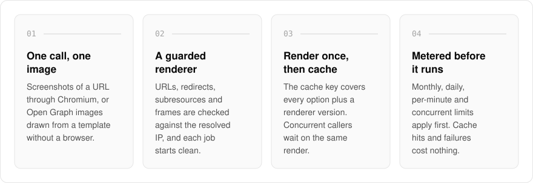
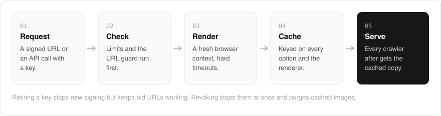

  <picture>
    <source media="(prefers-color-scheme: dark)" srcset=".github/assets/hero-dark.png">
    
  </picture>

<h1 align="center">snap.me.at</h1>

<strong>Turn any URL or template into a share image.</strong>

  
  
  

  <a href="#features">Features</a> ·
  <a href="#how-it-works">How it works</a> ·
  <a href="#screenshots">Screenshots</a> ·
  <a href="#built-with">Built with</a>

A screenshot service is a browser that fetches whatever URL a stranger hands it, and rendering the same image again for every crawler wastes time and money. I built snap.me.at to produce screenshots and Open Graph images from a URL or a template in one API call, cached and metered per render: each image renders once, and every crawler after that gets the cached copy. The safety work came first, a renderer that cannot reach anything it should not. The render pool, URL guard, rate limits, cost model and signing scheme are written and tested, but the public API does not return an image yet.

  <picture>
    <source media="(prefers-color-scheme: dark)" srcset=".github/assets/overview-dark.svg">
    
  </picture>

## Why snap.me.at

| The usual screenshot API | snap.me.at |
| --- | --- |
| Renders the same image again on every crawl | Renders once, then serves the cached copy |
| Fetches whatever URL it is given | Checks every URL, redirect, subresource and child frame against the resolved IP |
| Bills for cache hits and failed renders | Cache hits and failures cost nothing |
| Revoking a key leaves its images up | Revoking stops its signed URLs at once and purges cached images |

## Features

- **Screenshots and Open Graph images**: Chromium (via Playwright) captures pages; Open Graph templates are drawn without a browser.
- **SSRF-safe URL guard**: customer URLs are checked on submit and again on fetch against the resolved IP, and every redirect, subresource and child frame goes through the same guard.
- **A fresh browser context per job**: no stored data, cookies or service workers carried between jobs, with hard timeouts, download budgets and clamped viewports.
- **Render once, cache by every option**: the cache key covers every output-affecting option plus a renderer version, and concurrent callers wait on the render already in progress.
- **Signed URLs**: an HMAC over the parameters in a fixed order, scoped per surface, with unknown parameters rejected.
- **API keys with retire and revoke**: retiring stops new signing and keeps existing URLs working; revoking stops them at once and purges cached images.
- **Rate limits and a per-render cost model**: monthly, daily, per-minute and concurrent limits are checked before anything renders; cache hits and failures cost nothing.
- **MCP endpoint**: the tools are exposed over the Model Context Protocol, and tools that cost compute refuse without a session.

## How it works

  <picture>
    <source media="(prefers-color-scheme: dark)" srcset=".github/assets/flow-dark.svg">
    
  </picture>

A request arrives as a signed URL or an API call with a key, and limits plus the URL guard run before any browser starts. Each render gets a fresh browser context with hard timeouts, and the result is cached under a key built from every option that changes the output and the renderer version. Every request after that is served from the cache, and costs nothing.

## Screenshots

<table>
  <tr>
    <td width="50%"><picture><source media="(prefers-color-scheme: dark)" srcset=".github/assets/hero-dark.png"></picture> The landing page: what Snap does, with a status panel of what is built and what is not.</td>
    <td width="50%"><picture><source media="(prefers-color-scheme: dark)" srcset=".github/assets/templates-dark.png"></picture> Templates: the Open Graph template gallery, rendered by the engine itself in both themes.</td>
  </tr>
</table>

## Built with

  
  
  
  
  
  

- Next.js 16 (App Router), React 19, TypeScript
- Tailwind CSS 4
- Playwright (Chromium render pool)
- Next.js OG image rendering for templates
- Drizzle ORM + Postgres
- Better Auth
- oRPC + TanStack Query

## Part of the me.at family

snap.me.at is one of my [`*.me.at`](https://me.at) apps. They share one design system, account, and app shell. Development happens in a private monorepo; this repository is the project's public-facing home.

## License

Source-available. See [LICENSE](LICENSE).
